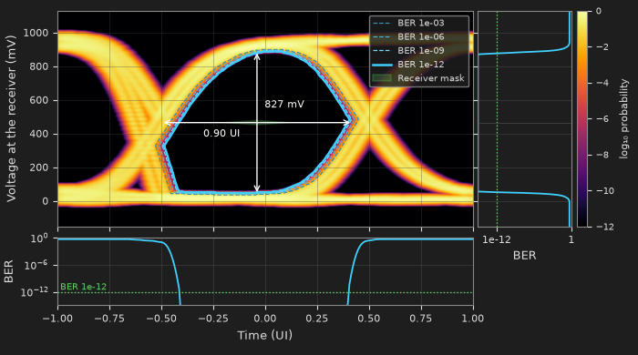
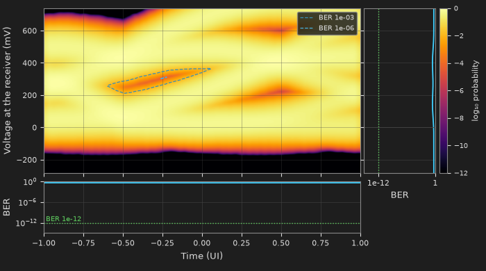
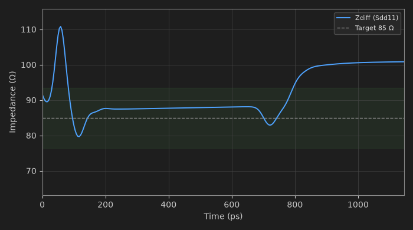
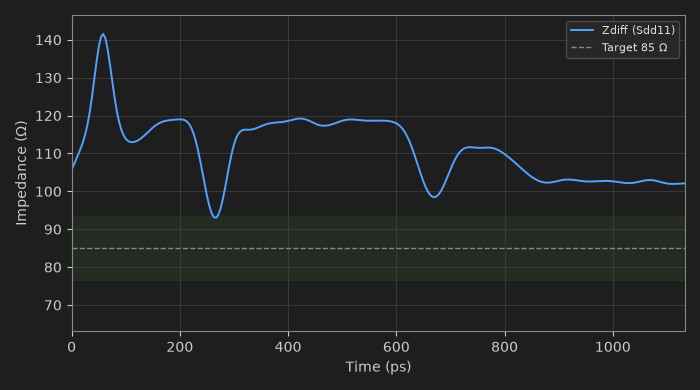
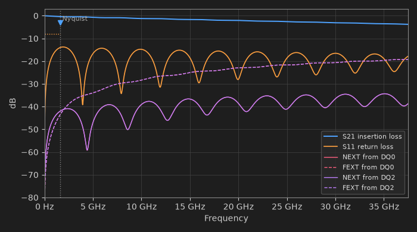
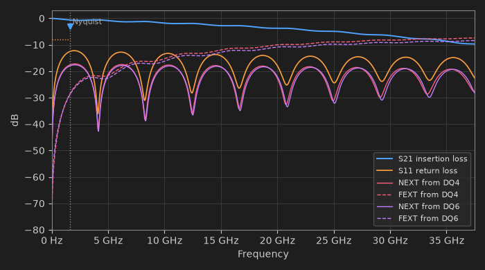

<p align="center">
  
</p>

<h1 align="center">KiPI-SI</h1>

<p align="center"><b>Power and signal integrity for your PCB, in 3D, inside KiCad or on its own.</b></p>

<p align="center">
  <a href="https://github.com/MohamoudAli12/KiPI-SI/actions/workflows/ci.yml"></a>
  <a href="LICENSE"></a>
  <a href="#install"></a>
  <a href="#install"></a>
  <a href="#install"></a>
</p>

KiPI-SI reads your board's copper, stackup, pads, vias and parts, meshes the copper, and
solves what actually happens on it: where the voltage drops, where the current crowds, how
hot the copper gets, how the power distribution network's impedance looks to a chip, how much
switcher noise lands on a signal trace, and whether a high-speed link's eye is open. Every
result is drawn on a rotatable 3D model of the board, checked PASS/FAIL against your limits,
and written to a report you can send to anyone.

It runs as a **KiCad 9 / 10 plugin** (one toolbar button) or **standalone**, opening KiCad,
ODB++ and HyperLynx board files without KiCad installed.

**Status: 0.9.3 (alpha, in development)** ([changelog](docs/CHANGELOG.md)). Treat results as an
engineering estimate and sanity-check anything surprising. KiPI-SI is a fork of
[KiPI](https://github.com/drewsum/KiPI) by Drew Maatman, extended with signal integrity.


## Contents

- [What KiPI-SI does](#what-kipi-si-does)
- [Quick start](#quick-start)
- [Install](#install)
  - [As a KiCad plugin](#as-a-kicad-plugin)
  - [Standalone](#standalone)
  - [Optional: the PARDISO solver](#optional-faster-solves-with-pardiso)
- [A tour of the window](#a-tour-of-the-window)
- [The four analysis modes](#the-four-analysis-modes)
  - [DC: voltage drop, current and temperature](#1-dc-voltage-drop-current-and-temperature)
  - [AC: PDN impedance](#2-ac-pdn-impedance)
  - [Coupled Noise: switcher noise on signals](#3-coupled-noise-switcher-noise-on-signal-nets)
  - [SI: signal integrity](#4-si-signal-integrity)
- [Use cases and recipes](#use-cases-and-recipes)
- [Example boards](#example-boards)
- [Files KiPI-SI reads and writes](#files-kipi-si-reads-and-writes)
- [Tips and troubleshooting](#tips-and-troubleshooting)
- [Documentation](#documentation)
- [Development](#development)
- [License](#license)

## What KiPI-SI does

Four analysis modes share one board model, one 3D view and one setup file. Pick a mode at
the start of the toolbar, or with **Ctrl+1** to **Ctrl+4**.

| Mode | The question it answers | What you set up | What you get |
|---|---|---|---|
| **DC** voltage drop | Does every chip get its voltage? Is any trace, via or plane overloaded or too hot? | Regulators (VRMs), loads, series parts | Voltage, current density, via current, copper losses and temperature in 3D; PASS/FAIL per load, VRM and via; HTML or PDF report |
| **AC** PDN impedance | Is the decoupling good enough? Where does the PDN resonate? | Capacitor RLC models, probes at a chip's pins, a target impedance | \|Z\| against frequency per probe with its target and margin, a board map, transient undershoot and overshoot |
| **Coupled Noise** | How much of the buck converter's switching noise reaches that ADC or clock trace? | A switcher as aggressor, signal nets as victims | Switch-node and ripple waveforms, noise at each receiver against its logic margin, the coupling path colored in 3D, near-field and radiated estimates |
| **SI** signal integrity | Are my impedances right? Is the return path broken anywhere? Will this USB, PCIe or DDR link work? | Nothing for a Quick Scan; a channel's interface and buffers for a full solve | PASS/WARN/FAIL per signal net; S-parameters, TDR, eyes, COM and waveforms per channel, checked against the interface's limits |

Everything is field-solved from the layout itself. Planes, thermal reliefs, necked traces, via
counts, anti-pads, cavity resonances and trace cross-sections come out of your copper, not
from hand-entered estimates.

## Quick start

### Plugin: your board, inside KiCad

1. In KiCad, enable **Preferences → Plugins → Enable KiCad API** (once).
2. Put the KiPI-SI folder in KiCad's plugins folder and restart the PCB editor
   ([details](#as-a-kicad-plugin)). Wait for the **KiPI-SI** toolbar button to appear.
3. Open your board and click **KiPI-SI**. The board is read and drawn in 3D.
4. Tick the power and ground nets on the left, add a VRM and a load on the right, and click
   **Solve all**. The Loads table tells you PASS or FAIL. Click the 3D view to probe voltages.

### Standalone: no KiCad needed

1. Install Python 3.10 to 3.13.
2. Put the KiPI-SI folder anywhere and start the launcher. It installs KiPI-SI's packages
   into an environment of its own the first time, after showing you what it will download.

   ```sh
   python kipi_si_launcher.py                 # Windows: double-click kipi_si_launcher.pyw
   ```

3. **Open…** a `.kicad_pcb`, an ODB++ job, a `.hyp` file or a KiPI-SI snapshot.

### Try it in two minutes, with no board of your own

```sh
python kipi_si_launcher.py examples/multiphase_buck/multiphase_buck.kipi_si.json.gz
```

This opens a 4-phase 12 V → 0.9 V, 40 A core rail with its power tree, loads, capacitor
models and probes already set up. Click **Solve all** for the DC result, then switch to
**AC** and click **Solve rail**. The other [example boards](#example-boards) do the same for
Coupled Noise and Signal Integrity.

## Install

KiPI-SI is one folder that runs two ways. The plugin reads the board open in KiCad and
needs the folder in KiCad's plugins folder, where KiCad installs the dependencies. Standalone
KiPI-SI opens board files, needs no KiCad, and can live anywhere. Both ways share the same
setup files, so you can switch freely.

### As a KiCad plugin

**Requirements**

- **KiCad 9.0 or later.** Developed on KiCad 10 and confirmed on KiCad 9. Before 9.0.3,
  KiCad cannot say which layers a plated pad has copper on, so pads are kept on every layer
  (KiPI-SI warns in its log), and 9.0.0 cannot report net classes.
- **Python 3.10 to 3.13**, the one KiCad runs plugins with. Some dependencies have no
  prebuilt packages for Python 3.14 yet.
  - **Windows:** KiCad's own Python 3.11. Nothing to do.
  - **Linux:** KiCad uses the system Python. On a distribution with Python 3.14 (Ubuntu
    26.04, Fedora 43), pip has to compile some packages, which needs
    `sudo apt install build-essential python3-dev` or the equivalent.
  - **macOS:** KiCad bundles Python 3.9, which is too old. Install Python 3.12 (python.org
    or Homebrew) and select it as the **Python interpreter** in *Preferences → Plugins*.

**Steps**

1. In KiCad, enable **Preferences → Plugins → Enable KiCad API**.
2. Put this repo in KiCad's plugins folder as `KiPI-SI`: clone it there, link it, or unzip
   `KiPI-SI-<version>.zip` from the
   [latest release](https://github.com/MohamoudAli12/KiPI-SI/releases/latest). The paths below
   are KiCad 10's; for KiCad 9 put `9.0` in place of `10.0`.

   ```powershell
   # Windows (KiCad uses your Documents folder, which may be redirected to OneDrive)
   $plug = "$([Environment]::GetFolderPath('MyDocuments'))\KiCad\10.0\plugins"
   New-Item -ItemType Junction -Path "$plug\KiPI-SI" -Target "<path to this repo>"
   ```

   ```sh
   ln -s "<path to this repo>" ~/Documents/KiCad/10.0/plugins/KiPI-SI          # macOS
   ln -s "<path to this repo>" ~/.local/share/kicad/10.0/plugins/KiPI-SI       # Linux
   ```

3. Restart the PCB editor. KiCad builds the plugin's environment in the background. The
   first time downloads PySide6 and VTK, so give it a few minutes. The **KiPI-SI** toolbar
   button appears once the environment is ready. If it never does, right-click the action in
   *Preferences → Plugins* and choose *Recreate Plugin Environment*.

### Standalone

1. Install **Python 3.10 to 3.13** from [python.org](https://www.python.org/downloads/) or
   your package manager. On Linux, also install `python3-venv` (Debian, Ubuntu) and, for the
   setup window, `python3-tk`.
2. Put the KiPI-SI folder anywhere: clone this repo, or unzip `KiPI-SI-<version>.zip` from the
   [latest release](https://github.com/MohamoudAli12/KiPI-SI/releases/latest).
3. Start the launcher: double-click **`kipi_si_launcher.pyw`** on Windows, or run

   ```sh
   python kipi_si_launcher.py                        # open boards from the window
   python kipi_si_launcher.py <board>.kicad_pcb      # or open one straight away
   ```

The first start shows a setup window listing every package with its size (about 254 MB to
download on Windows). Nothing is installed until you click **Install**. Everything goes into
an environment of KiPI-SI's own, outside the KiPI-SI folder (`KIPI_SI_HOME` puts it elsewhere):

| Platform | KiPI-SI's environment |
|---|---|
| Windows | `%LOCALAPPDATA%\KiPI-SI` |
| macOS | `~/Library/Application Support/KiPI-SI` |
| Linux | `~/.local/share/kipi_si` |


On Windows the first start leaves a **KiPI-SI** shortcut next to the launcher. On Linux and
macOS, `python3 kipi_si_launcher.py --create-shortcut` adds KiPI-SI to the applications menu
or `~/Applications`.

Standalone KiPI-SI opens these board files with **Open…** and re-reads them with **Reload**:

| Format | Files | Notes |
|---|---|---|
| KiCad 7 to 10 | `.kicad_pcb` | Uses the zone fills saved in the file: **fill zones (B) and save** in KiCad first |
| ODB++ | `.zip`, `.tgz`, `.tar.gz`, or an unpacked job folder | Exported from Altium, Allegro, PADS, Eagle and others |
| HyperLynx | `.hyp` | Exported from most layout tools |
| KiPI-SI snapshot | `.kipi_si.json.gz` | A board saved by KiPI-SI; opens anywhere without the design files |

A board's setup is shared across formats when the files sit next to each other with the same
name (`Board.kicad_pcb`, `Board.zip`, `Board.hyp`). The [user guide](docs/help.html) lists
what each format does and does not carry. Reading CCE files is on the way
([#143](https://github.com/MohamoudAli12/KiPI-SI/issues/143)); if you have a board in another
format you would like supported, please open an
[issue](https://github.com/MohamoudAli12/KiPI-SI/issues) and attach it.

To change the setup later, use **About → Manage dependencies…** in KiPI-SI, or the launcher:

```sh
python kipi_si_launcher.py --setup              # the setup window again (add or remove PARDISO)
python kipi_si_launcher.py --add-pardiso        # or --remove-pardiso, without questions
python kipi_si_launcher.py --repair             # reinstall everything from scratch
python kipi_si_launcher.py --reset              # delete KiPI-SI's environment
python kipi_si_launcher.py --create-shortcut    # Start menu / applications menu / ~/Applications
```

If setup fails, the launcher says why, and everything the installer printed is in the `logs`
folder next to the environment.

### Optional: faster solves with PARDISO

With the optional [`pypardiso`](https://pypi.org/project/pypardiso/) package, KiPI-SI solves
with Intel MKL's multithreaded PARDISO solver in place of SciPy's single-threaded one. On a
645k-unknown rail one solve drops from about 8 s to 1.2 s. Small boards gain little. It
costs about 210 MB of download on Windows (320 MB on Linux). There are no MKL packages for
macOS or ARM.

The plugin gets it with its other requirements. Standalone, the launcher's first setup
installs it by default, with an opt-out, and *About → Manage dependencies…* adds or removes
it later. *About → Copy version info* shows which solver is in use. If PARDISO cannot load,
KiPI-SI falls back to SciPy and says so in the log.

## A tour of the window


The window has the same shape in every mode.

- **Toolbar** (top): the mode switch (**DC / AC / Noise / SI**), **Load from KiCad** or
  **Open…** and **Reload**, **Save snapshot… / Open snapshot…**, **Power tree**, **Stackup**,
  **Report** and **Help** (or **F1**). When the board comes from a running KiCad, **Refill
  zones** (on by default) refills every zone before reading, so what KiPI-SI sees matches
  your current routing.
- **Board panel** (left): the **Nets** list, where you tick the nets to analyze. **Power &
  ground only**, **All power** and **None** help choose. In SI mode the list switches to
  signal nets, grouped into differential pairs, single-ended and slow control nets. Below
  it: **Copper layers**, **Display** options (color by layer or net, Z scale, vias, pads,
  mask, silkscreen, part **3D Models**) and **PI Models**, which marks the parts of the
  current analysis in 3D.
- **3D view** (centre): drag to rotate, scroll to zoom, shift-drag or middle-drag to pan.
  Click anything to see it in the **Info** box, and **Select in KiCad** to find it in the
  PCB editor. Selected nets are drawn in full colour over a dimmed board.
- **Setup panel** (right): the analysis you are modelling, in tabs. Every list has **Add**,
  **Duplicate** and **Remove**. Pins are chosen with a picker (net, then part, then pins), and
  KiPI-SI pre-fills what follows from them: a VRM's voltage from the net name, ground pins, a
  series link's other side, a resistor's value. Problems are shown in red.
- **Results** (bottom centre): the field shown in 3D, the result tables, plots and
  **Export ▾**.
- **Log** (bottom): each stage streams here as it runs. **Cancel** stops a solve.

Two toolbar windows help you understand the board before solving:

| Power tree | Stackup |
|---|---|
|  |  |
| A block diagram of the modelled power network, left to right in the direction power flows. Saves as PNG. | Every copper and dielectric layer with thickness, material, εr, thermal conductivity and resistivity, drawn to scale. Untick **Lock to imported values** to try other thicknesses and materials: every analysis uses the edited stackup. |

Every control has a tooltip, and the [user guide](docs/help.html#keys) lists every keyboard
shortcut.

## The four analysis modes

### 1. DC: voltage drop, current and temperature

*The default mode and the most common first run. Does every load get its voltage, and is any
copper or via overloaded?*

**Set up the power tree** on the **PI setup** panel. **Auto-fill power tree** finds every
regulator and source on the board and fills every rail at once, with a preview to check. Or
build it by hand:

- **VRMs tab**: one entry per regulator, power input or ideal supply. A VRM is a **Source**,
  **LDO**, **Switcher** or **Isolated** converter, with its output pins and target voltage,
  its input pins (which link it to the rail upstream), efficiency or quiescent current, and
  optional remote sense, ground pins, load line, dropout, input range, DC accuracy, current
  limit and multiple **Phases**. KiPI-SI works out each VRM's input current from everything it
  feeds, so a whole chain (input → switcher → LDO) solves at once. Untick a VRM to leave its
  rail out of a solve.
- **Loads tab**: one entry per consumer: its **Supply pins**, **Current** (split evenly or by
  pin group), optional **Ground pins** and a **Tolerance** for PASS/FAIL. **Auto-fill rail**
  reads currents from the parts' `PI_I` fields or the `pi_parts.yml` library. **Load models**
  save and apply a part's supplies as a YAML file.
- **Series links tab**: parts that pass DC from one net to another: sense resistors, ferrite
  beads, fuses, load switches, 0 Ω links. **Import SPICE model…** uses the maker's model for
  DC and AC, including diodes and multi-pin parts such as common-mode chokes. Both nets on
  either side of a link must be ticked in the Nets list.
- **Solve tab**: every combined rail with a checkbox. Untick the rails not routed or modelled
  yet and solve the rest.
- **Mesh tab**: **Max edge** is the largest mesh triangle edge in mm (smaller is more
  accurate and slower), and **Via plating** sets each via type's plating thickness and fill.
- **Thermal tab** (off by default): **Electro-thermal co-simulation** makes copper losses heat
  the board and the warmer copper more resistive, layer by layer, with heat crossing the
  laminate and running down vias. Set ambient, airflow and temperature limits. Inspired by
  [KiCad Thermal Sim](https://github.com/PoeAlex/KiCad_Thermal_Sim).

| Loads | Mesh and via plating | Thermal |
|---|---|---|
|  |  |  |

**Solve** with **Solve all**. Every rail is meshed and solved, downstream loads first.
Progress streams into the log.

**Read the results.** Choose a **net group** and a **field**: **Voltage**, **Current
density** (tick **Arrows** to see the flow), **Power density**, **Via current** or
**Temperature**. Click any point to probe it, and narrow the **Color scale** to look closer.


| Via current | Temperature |
|---|---|
|  |  |

The result tabs give **Loads** (effective voltage, drop and PASS/FAIL), **VRMs** (input
current, conversion loss, regulation), **Series links** (I²R losses), **Vias** ranked by
current against a per-via limit, **Losses**, **Thermal** and **Notes**.

**Report** writes a single portable HTML file next to the board with the summary tables, an
interactive 3D view per rail, per-layer voltage and current-density maps, the temperature map
and a user-notes box. Or choose **PDF**. **Export ▾** writes CSV or ParaView files, and
**Save results…** stores the solve for **Open results…** later.

| Summary tables | Interactive 3D per net group |
|---|---|
|  |  |

### 2. AC: PDN impedance

*Is the decoupling enough, and where does the power distribution network resonate?*

Switch to **AC**. VRMs and series links are shared with DC mode. The **AC setup** adds:

- **Capacitors tab**: RLC models (capacitance, ESL, ESR) for the decoupling capacitors, each
  shared by a group of identical parts, or the maker's SPICE model. **Auto-fill rail** adds a
  model per value and package from the board; **Models from values** starts one per value.
  Models can be derated for DC bias, temperature, aging and tolerance. Model capacitors of
  the same value in different case sizes separately.
- **Probes tab**: where to plot the impedance, usually a device's supply and ground pins
  (**From DC load** takes them from a DC load), each with a **flat** or **custom** target.
  The **Target Impedance/Frequency Calculator** works out a flat target from the device's
  voltage tolerance and load step, after Smith et al.,
  ["Power Distribution System Design Methodology and Capacitor Selection for Modern CMOS Technology"](https://doi.org/10.1109/6040.784476)
  (IEEE Trans. Adv. Packaging, 1999). Targets apply above the VRM's **Control loop bandwidth**.
- **Sweep tab**: frequency range, resolution and the deratings.
- **Mesh tab**: mesh size and the minimum edge at plated holes.

| Capacitor models | Target calculator |
|---|---|
|  |  |

Pick the **Rail** and **Ground** and click **Solve rail**. The rail's copper and its ground
are field-solved, so plane resistance, spreading inductance, plane capacitance, cavity
resonances and via inductance all come from the layout. The capacitors and series links are
attached at every frequency. The VRM is not modelled as an impedance (the open-loop PDN).
AC is the heaviest computation in KiPI-SI: many probes and a fine mesh take much longer.

The **Impedance** tab plots |Z| against frequency for every probe with its target and a
cursor to read values (linear or log axis). The **Board map** shows the mesh, probes and
capacitors, and the **Transient** tab estimates each probe's undershoot and overshoot for its
load step. **Report**, **Export CSV…** and **Save results…** work as in DC mode.


### 3. Coupled Noise: switcher noise on signal nets

*How much of a buck or boost converter's switching noise lands on the signal traces around
it, and through which path?*

Switch to **Noise**. One of the setup's **Switcher** VRMs becomes the *aggressor*, and the
signal nets you name are the *victims*.

- **Aggressors tab**: **Add** makes an aggressor from a switcher VRM and fills it in from the
  board: the switching device, inductor, switch node and capacitors. Give the switching
  frequency and edge times; datasheet values such as Coss and Qrr are optional. KiPI-SI traces
  each capacitor's hot loop through the copper for its inductance and coupling.
- **Victims tab**: each victim is a net with its driver and receiver pins, a **Type** (CMOS,
  open drain, terminated, LVDS, analog input or undriven) and a **Logic level**, which set
  its loading and noise margin.
- **Capacitors tab**: the same capacitor models as AC mode.
- **Settings tab**: harmonics, damping, victim resolution and the **Board model**, the slower
  but more accurate field model of the converter's copper.

Pick the **Aggressor** and click **Solve**. Tick **Scan nearby nets** to also check every
signal net near the aggressor.

The **Waveforms** tab plots the switch node with its ringing, the inductor and capacitor
currents and the rail ripple, in time or as a spectrum.


The **Results** table lists each victim's peak noise at its receiver, its margin, the
dominant mechanism and PASS or FAIL. **Victim noise** plots the noise as a whole or by
mechanism, and **Victim held high and low** draws it riding on the receiver's high and low
levels against its thresholds.

| Victim noise by mechanism | Held high and low |
|---|---|
|  |  |

**Coupling in 3D** colours the victim's traces by their share of the peak noise, so the
pieces to move stand out. **Hot loops in 3D** draws the capacitor loops' current, and
**Fields in 3D** the H and E fields over the board, with near-field hotspots and a first
radiated estimate against CISPR 32 class B. Victims crossing a split in their reference plane
are flagged.


Each mechanism points to a different fix: capacitive noise comes from the switch node's
dV/dt, inductive noise from the hot loop's dI/dt, and common noise from the switching
current's return path.

### 4. SI: signal integrity

*Are the impedances right, is the return path intact, and will this link's eye be open?*

Switch to **SI** (**Ctrl+4**). The Nets list switches to signal nets, grouped into
differential pairs (found by name: `_P`/`_N`, `+`/`-`, `DP`/`DM`, or set by hand with a
right-click), single-ended nets and slow control nets.

**Quick Scan: every signal net in minutes.** Click **Scan**. Each net is cut into short
sections and every cross-section is field-solved with its neighbours. Each net gets PASS,
WARN or FAIL for:

- impedance (Z0, or Zdiff for pairs) along its length,
- its worst crosstalk coefficient to a neighbour,
- its return path: lengths with no reference plane, crossings of a plane gap, and layer
  changes without a return via nearby,
- via stubs that resonate in band,
- pair skew.

**Impedance in 3D** colours the traces by how far they are from target. Cuts that come out
alike are solved once, in parallel on the CPU's cores: a 6-layer board with about 400 signal
nets scans in a few minutes, and a rescan takes seconds. Slow control nets (enables, resets,
LEDs, I²C, JTAG) are left out unless **Slow nets** is ticked.

**Channels: a full solve of one link.** A channel is a net or a pair followed from its
transmitter, through series resistors and AC-coupling capacitors, to its receiver. **Make a
channel** turns a scanned net into one; **Add bus…** makes one for every net between a
transmitting part and a receiving part (a DDR byte lane, an ADC's lanes), with its
neighbours as aggressors. For each channel you pick:

- its **Interface**, which sets the rate, swing, edges, terminations, equaliser and limits
  (any can be overridden): Custom, LVDS, USB 2.0, USB 3.2 Gen 1 and 2, USB4 Gen 2 and 3,
  PCIe Gen 2 to 5, SATA III, HDMI 2.0, SGMII / 1000BASE-X, 10GBASE-KR, MIPI D-PHY, DDR4 DQ
  or CMOS logic;
- its **buffers**: generic ones, or a model from a manufacturer's **IBIS** file at a corner;
- its **Aggressors**, for near- and far-end crosstalk.

The channel is extracted from 2D field-solved lossy coupled line sections (with
Djordjevic-Sarkar dielectrics and Hammerstad, Groisse or Huray copper roughness) and physics
based via models (barrel, pads, anti-pads, stubs, and the return through each plane pair,
with stitching vias and decoupling capacitors). Tick several channels and **Solve** runs them
one after another.

**Results** gives every check (impedance, insertion and return loss at Nyquist, mode
conversion, skew, the eye against the receiver mask, COM, overshoot, ringback, monotonic
edges, crosstalk) and the **SI plots**: the eye (statistical at the target BER with the best
FFE, CTLE and DFE, or the raw or PRBS eye), the voltage and timing bathtubs, TDR,
S-parameters, waveforms at the dies and the pulse response. **Solved channels compared** puts
every channel side by side.

| A good channel | A bad channel |
|---|---|
|  |  |
|  |  |
|  |  |

**Export Touchstone…** writes the channel's `.s2p` or `.s4p`, and **Export SPICE…** a passive
rational model of it as a SPICE subcircuit for any circuit simulator. **Report** writes one
channel and **Report several…** a report of all the solved ones; **Save results…** keeps
them for later. The **Settings** tab holds section length, etch, roughness model, the sweep
and the scan's limits.

New to signal integrity? The user guide's *Reading SI results* section explains every plot
and check in plain terms, with a good and a bad channel side by side.

## Use cases and recipes

Short recipes for the things people most often open KiPI-SI for. The
[user guide](docs/help.html) has the long form of each.

<details>
<summary><b>A first IR-drop check of one rail</b></summary>

1. Tick the rail and its ground in the Nets list. Untick everything else.
2. VRMs tab: **Add** a **Source** on the regulator's output pins at the target voltage, with
   its ground pins.
3. Loads tab: **Add** each consumer with its current, tolerance and ground pins.
4. **Solve all**. For a FAIL in the Loads table, double-click the row, choose **Voltage** and
   click around the load's pins to see where the drop comes from.
5. Switch to **Current density** with **Arrows** to find the bottleneck. Change the layout in
   KiCad, then **Load from KiCad** and **Solve all** again.
</details>

<details>
<summary><b>A full power tree: input → switcher → LDO</b></summary>

1. Tick every rail in the chain and the ground, or click **Auto-fill power tree** and check
   the preview.
2. Add the input as a **Source** (the 12 V connector), the switcher as a **Switcher** with
   its efficiency, output pins (its inductor), **Input pins** on the 12 V net and ground
   pins, and the LDO as an **LDO** with its quiescent current, dropout and **Input pins** on
   the switcher's output.
3. Add loads on each rail and solve. The VRMs table shows each converter's input current,
   which includes everything downstream, and its conversion loss.
4. Set **Input range** and **Dropout** to catch a regulator starved by upstream drop. Its
   loads then show *VRM OUT OF REGULATION*.
</details>

<details>
<summary><b>A multi-phase regulator</b></summary>

1. Add the VRM with phase 1's output pins (its inductor), input pins and ground pins.
2. Set **Phases**. Each new phase takes the next parts in sequence (`L1`, `Q1` → `L2`,
   `Q2`), or the same parts on the next sheet (`L101` → `L201`). Check each in **Edit phase**.
3. Solve. Each phase carries an equal share and settles at whatever voltage its copper
   needs. Unequal phase voltages in the VRMs table show a layout imbalance.
</details>

<details>
<summary><b>Remote sense</b></summary>

1. On the VRM, set **Sense pins** to where the feedback trace connects, often the load's
   supply pins. For differential sensing, also set **Ground sense pins**.
2. Solve. The sense point sits exactly at the regulated voltage; pins nearer the VRM read
   above it. The tolerance check catches both directions.
3. To hold several points at once, tick **Mesh sense** and pick each point's pins.
</details>

<details>
<summary><b>Thermal and current-capacity checks</b></summary>

1. Thermal tab: tick **Electro-thermal co-simulation**, set ambient, airflow and the limits
   for maximum temperature and rise.
2. On the Vias results tab, set the per-via **Current limit** from your fab's rating.
3. **Solve all**. Read the Thermal tab for the hottest point per layer, sort the Vias tab by
   current for overloaded vias, and show the **Temperature** field for the map.
</details>

<details>
<summary><b>Designing decoupling to a target impedance</b></summary>

1. Make sure the rail has a VRM (a Source is fine), and tick the rail, its ground and any
   nets joined by series links.
2. Switch to **AC**. Capacitors tab: **Auto-fill rail** or **Models from values**, then check
   each model's ESL and ESR against the datasheets.
3. Probes tab: add a probe on the device's power and ground pins. Use the calculator for the
   target, or a custom mask from the vendor.
4. **Solve rail**. Put the cursor on the worst peak (the table's **Worst |Z|** says where).
5. Change capacitor models or the layout and solve again. Each probe's margin in dB shows
   the improvement.
</details>

<details>
<summary><b>Will this switcher upset my ADC, clock or reset line?</b></summary>

1. Model the switcher as a **Switcher** VRM in DC mode, and give its capacitors AC models.
2. Switch to **Noise**. **Add** an aggressor from the switcher, enter the switching frequency
   and edge times.
3. Add the sensitive nets as victims with their type and logic level, or tick **Scan nearby
   nets** to let KiPI-SI find them.
4. **Solve**. For a FAIL, open **Coupling in 3D** to see which trace segment picks up the
   noise and which mechanism dominates, then move that segment or shrink the hot loop.
</details>

<details>
<summary><b>Pre-layout-review scan of every signal net</b></summary>

1. Switch to **SI** and click **Scan**.
2. Sort the table by status. Fix the FAILs first: a plane gap under a trace, a layer change
   without a return via, an impedance far off target.
3. Show **Impedance in 3D** to see where along each trace the impedance drifts.
4. Rescan after the fix. Rescans take seconds.
</details>

<details>
<summary><b>Qualifying a USB, PCIe, SATA, HDMI or DDR link</b></summary>

1. In **SI**, select the net or pair and click **Make a channel**, or **Add bus…** for a
   whole byte lane.
2. Pick the **Interface** and, if you have them, the IBIS models of both ends.
3. **Solve**. Read the eye against the receiver mask and the check list. **Export
   Touchstone…** or **Export SPICE…** to carry the channel into another simulator.
</details>

<details>
<summary><b>Analysing a board from Altium, Allegro, PADS or another tool</b></summary>

Export the board as ODB++ or HyperLynx, start KiPI-SI standalone and **Open…** the file. Set
up and solve as for a KiCad board. Put the exported file next to the KiCad board with the
same name to share one setup across formats.
</details>

<details>
<summary><b>Sharing a board and its results, or working offline</b></summary>

- **Save snapshot…** stores the board as a `.kipi_si.json.gz`. Anyone with KiPI-SI can open
  it, without KiCad or your design files.
- Keep `<board>.kipi_si-setup.yml` in version control next to the board. It is saved on every
  solve.
- **Report** with **HTML** gives a single file that needs nothing but a browser.
- **Save results…** keeps a long solve for **Open results…** later.
</details>

<details>
<summary><b>Importing a power tree instead of typing it</b></summary>

- **Import…** in the DC setup reads a [Tomachie](https://tomachie.com) power-tree file
  (`<design>.pdn.json`): every rail, regulator, series part and load with datasheet values.
- Put `PI_I`, `PI_R`, `PI_TOL`, `PI_VRM`, `PI_V`, `PI_ESL` and the other `PI_*` fields on
  your schematic symbols, or fill a `pi_parts.yml` library next to the board, and
  **Auto-fill** reads them.
- The setup file is plain YAML. Scripts and AI agents can write it directly.
</details>

<details>
<summary><b>Scripting and headless extraction</b></summary>

```sh
python -m kipi_si --dump board.kipi_si.json.gz   # extract the board open in KiCad to a snapshot, no window
python -m kipi_si board.kipi_si.json.gz          # open a board file standalone
KIPI_SI_HOST=plugin python -m kipi_si            # run the plugin workflow from a terminal
```

These need KiPI-SI's packages on the Python you run them with (a `uv sync` checkout, or the
launcher's environment).
</details>

## Example boards

Every example opens with **Open…** standalone, **Open snapshot…** in the plugin, or from the
command line as in the quick start.

| Example | What it shows | Modes |
|---|---|---|
| [`examples/multiphase_buck`](examples/multiphase_buck) | A 4-phase 12 V → 0.9 V, 40 A core rail with its power tree, loads, capacitor models and probes | DC, AC |
| [`examples/validation/coupled_noise`](examples/validation/coupled_noise) | A 12 V to 1.8 V, 1 MHz buck over a ground plane with three victim nets | Noise |
| [`examples/signal_integrity`](examples/signal_integrity) | A clock net through a series resistor and a USB pair changing layers through vias, with a channel for each | SI |
| [`examples/si_demo`](examples/si_demo) | A full KiCad project (schematic and 6-layer PCB) with good and bad versions of PCIe, USB 3, USB 2 over a plane slot, DDR byte lanes and a clock, each as a channel | SI |
| [`examples/validation`](examples/validation) | Small boards with hand-calculable answers, used by the accuracy tests | DC, AC |

## Files KiPI-SI reads and writes

| File | What it is |
|---|---|
| `<board>.kipi_si-setup.yml` | The setup: ticked nets, VRMs, loads, series links, capacitor models, probes, aggressors, victims, channels and settings. Saved next to the board on **Save** and on every solve. Put it in version control. |
| `*.kipi_si.json.gz` | A board snapshot: copper, stackup, pads, vias and parts, openable anywhere. |
| `pi_parts.yml` | The parts library for **Auto-fill**: currents, resistances, ratings and roles by part number. |
| `*.kipi_si-load.yml` | A load model: one part's supplies with their currents, tolerances and AC targets. |
| `<design>.pdn.json` | A Tomachie power tree, read by **Import…**. |
| `*.kipi_si-dc-results`, `-dc-thermal-results`, `-ac-results`, `-noise-results`, `-si-results` | Saved solves, reopened with **Open results…**. |
| `kipi_si_reports/*.html`, `*.pdf` | Reports from the **Report** button. |
| `*.s2p`, `*.s4p` | A channel's S-parameters (Touchstone). |
| `*.csv`, `*.vtm` | Tables, impedance curves, and DC 3D results for ParaView. |
| `kipi_si-<date>-<time>-<pid>.log` | The session log, in `kipi_si/` under the temporary folder, with a matching `.crash.log`. |

## Tips and troubleshooting

- **A load shows DISCONNECTED.** Usually unrouted copper, an unfilled zone, or a missing
  series link for a part sitting between two power nets.
- **Unexpected voltage drop.** Thermal reliefs, necked traces, via counts and anti-pads in
  planes dominate DC drop. The Current density view with **Arrows** shows the bottleneck.
- **Slow solves.** Raise **Max edge**, analyze fewer nets at a time, or install
  [PARDISO](#optional-faster-solves-with-pardiso) on Intel x86.
- **Nothing happens on a `.kicad_pcb` opened standalone.** KiPI-SI reads the zone fills saved
  in the file. Fill the zones in KiCad (B) and save first.
- **"KiPI-SI works with one KiCad at a time"** although only one is open: a KiCad that did not
  exit cleanly may still be running. End it in the task manager.
- **Bug reports.** Attach the session log and its `.crash.log` from the temporary folder,
  and **About → Copy version info**, to an
  [issue](https://github.com/MohamoudAli12/KiPI-SI/issues).
- **Have fun.** See what happens when you pump 10 A into a 5 mil trace with the Temperature
  view. Please share what you have simulated and what you found.

## Documentation

The full documentation is online at **<https://mohamoudali12.github.io/KiPI-SI/>**.

| Where | What |
|---|---|
| **Help** button or **F1** in KiPI-SI ([`docs/help.html`](docs/help.html)) | The user guide: every button, workflow and result, offline, in one HTML file. Open it in a browser. |
| [`docs/solver-guide.html`](docs/solver-guide.html) | The Solver Guide: what power integrity is, why it matters, and how the mesh and the DC, thermal, AC and noise solvers work. |
| [Documentation site](https://mohamoudali12.github.io/KiPI-SI/) | The same material online (getting started, interface, each mode, workflows, theory, reference), built from [`docs_sphinx/`](docs_sphinx/README.md) and published on every push to main. |
| [`docs/CHANGELOG.md`](docs/CHANGELOG.md) | What changed in each version. |
| [`docs/research.md`](docs/research.md) | Background notes and references for the methods. |
| Tooltips | Every control in KiPI-SI explains itself on hover. |

## Development

The project is managed with [uv](https://docs.astral.sh/uv/). From a checkout, KiPI-SI runs
standalone, or as the plugin against the running PCB editor:

```sh
uv sync                                        # .venv from uv.lock: the plugin's packages and the dev tools
uv run python -m kipi_si tests/data/synthetic.kipi_si.json   # standalone, opening a board
KIPI_SI_HOST=plugin uv run python -m kipi_si   # the plugin: connect to KiCad
uv run python -m kipi_si --dump board.kipi_si.json.gz        # extract from KiCad only, no window
uv run pytest tests
uv run ruff check .                            # lint, as CI does (ruff check . --fix fixes most)
uv run prek install                            # git hooks: ruff on commit (once per clone)
```

On Windows PowerShell, set the variable first: `$env:KIPI_SI_HOST = "plugin"; uv run python -m kipi_si`.
`uv sync -p 3.11` builds the environment on another Python, such as the one your KiCad runs.

**Dependencies** live in `pyproject.toml`: `dependencies` for standalone, the `kicad` extra for
the plugin, and the `lint`, `test`, `dev` and `docs` groups. Add or change one with `uv add`
and commit the updated `uv.lock`; CI fails if the lock is out of date. KiCad and the launcher
do not use uv: `requirements.txt` is what KiCad installs and `requirements-standalone.txt`
what the launcher installs, so update them by hand; `tests/core/test_requirements.py` keeps
them in step. After changing them, run `uv run python .github/scripts/dep_sizes.py`.

**Tests** follow the package (`tests/core`, `tests/dc`, `tests/ac`, `tests/noise`, `tests/si`,
`tests/sources`, `tests/gui`, `tests/launcher`). `tests/accuracy` solves the boards in
[`examples/validation`](examples/validation) and compares the results with hand calculations:

| Board | Checks |
|---|---|
| `skinny_traces` | 0.15 mm and 0.1 mm tracks on outer and inner layers (ρL/wt), an arc track |
| `right_angle` | an L route and a Z route: 0.5587 squares per right-angle corner |
| `layer_change` | a strip dropping from F.Cu to In2.Cu through a row of vias: barrels in parallel, current crowding |
| `planes` | two pads on a disc-shaped inner plane (method of images); one strip on two layers of different weights |
| `power_chain` | source, switcher, ferrite series link and remote-sensed LDO over a ground strip |
| `ac_plane` | plane-pair capacitance ε₀εrA/h and the first cavity resonance c/(2a√εr) |
| `ac_decap` | a mounted capacitor as a series RLC: capacitance, mounted inductance, ESR at resonance |
| `ac_ferrite` | a ferrite (R + L link) feeding a small plane: lumped impedance and its LC resonance |
| `coupled_noise` | a buck over a ground plane with capacitive, inductive and common-ground victims |

After changing a board there, rerun `python examples/validation/make_boards.py [name]` (or the
example's own `make_board.py` / `make_project.py`) and commit its files.

CI runs ruff and the test suite for every push and pull request on Windows, Linux (Python
3.10 to 3.13) and macOS; the accuracy tests run for pull requests into `main`.
`tests/helpers/kicad_fake.py` stands in for each KiCad version from 9.0.0 to 10.0.6.
Releases are versioned with `uv run bump-my-version bump patch|minor|major`.

### Codebase layout

| Path | Purpose |
|---|---|
| `kipi_si_entry.py`, `plugin.json` | KiCad IPC plugin action (runs KiPI-SI as the plugin) |
| `kipi_si/__main__.py` | `python -m kipi_si`: standalone, or the plugin with `KIPI_SI_HOST=plugin` |
| `kipi_si_launcher.py`, `.pyw` | Standalone launcher: sets up KiPI-SI's environment on the first start, then starts KiPI-SI in it |
| `kipi_si/launcher/` | The launcher itself, standard library only: environment, Python discovery, package list, installer and setup screens |
| `kipi_si/host.py` | Plugin or standalone: how KiPI-SI was started |
| `kipi_si/core/` | Shared by every analysis: board model, copper geometry, meshing, sparse solvers, 3D meshes, progress reporting |
| `kipi_si/sources/` | Where boards come from: the running KiCad (IPC), `.kicad_pcb` files, ODB++, HyperLynx and snapshots |
| `kipi_si/dc/` | DC analysis: conduction FEM, power-tree setup, auto-fill and solve, thermal, reports, results views and panel |
| `kipi_si/ac/` | AC analysis: PDN impedance over frequency, field solver and sweep, targets, transient, report and panel |
| `kipi_si/noise/` | Coupled Noise: waveforms, hot-loop parasitics, coupling extraction, victim solves, fields, report and panel |
| `kipi_si/si/` | Signal Integrity: 2D cross-section field solver, via models, channel circuit, S-parameters, IBIS, transient, eyes and equalisers, Quick Scan, report and panel |
| `kipi_si/gui/` | PySide6 application shell shared by every mode: main window, mode switch, 3D viewer, worker threads, About and Help |
| `kipi_si/compat.py` | Opens results files saved by earlier versions |
| `docs/` | The user guide, Solver Guide, changelog, research notes and screenshots |
| `docs_sphinx/` | The Sphinx documentation site |
| `examples/` | Example boards with their setups, and the scripts that generate them |
| `tests/` | The test suite, with fakes for each KiCad version |

## License

KiPI-SI is free software: you can redistribute it and/or modify it under the terms of the
[GNU General Public License](LICENSE) as published by the Free Software Foundation, either
version 3 of the License, or (at your option) any later version. It is distributed WITHOUT
ANY WARRANTY; see the license for details. Copyright © 2026 Drew Maatman (KiPI) and
the KiPI-SI contributors.

**Note on the mesher.** KiPI-SI meshes copper with Jonathan Shewchuk's
[Triangle](https://www.cs.cmu.edu/~quake/triangle.html), through the
[`triangle`](https://pypi.org/project/triangle/) Python package. Triangle is not open source
in the OSI sense. Its author's terms allow free use and redistribution, but it **may not be
sold or included in commercial products without a license from its author**. Using KiPI-SI
for your own design work is fine. The meshing code is isolated in `kipi_si/core/mesh/` for
this reason.

The other dependencies are under permissive licenses, apart from PySide6 (LGPL-3.0). All of
them are compatible with the GPL.

The author of KiPI-SI prohibits the package from inclusion in commercial software. Use it,
fork it, and modify it to your heart's content.
